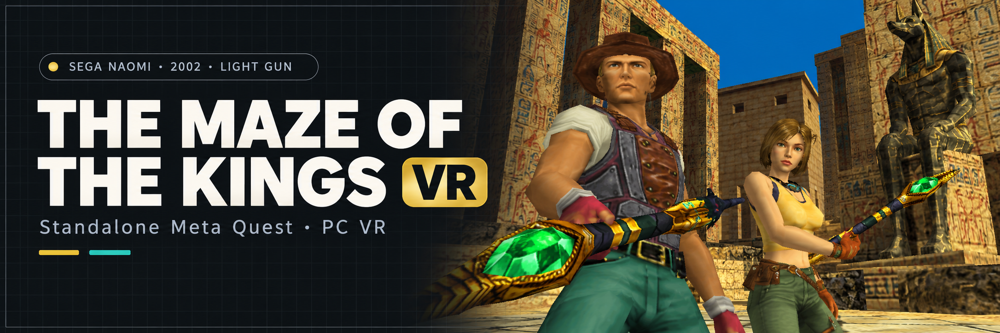

<p align="center">
  
</p>

<h1 align="center">The Maze of the Kings VR</h1>
<p align="center"><strong>The original NAOMI adventure, inside your headset.</strong><br>Standalone Meta Quest · Windows PC VR</p>
<p align="center">
  
  
  
</p>
<p align="center">
  <a href="https://github.com/vr4all-standalone/mok-vr/releases/latest/download/mok-vr-quest.apk"><strong>Download Quest APK</strong></a> ·
  <a href="https://github.com/vr4all-standalone/mok-vr/releases/latest/download/mok-vr-pcvr.zip"><strong>Download PC VR ZIP</strong></a> ·
  <a href="https://github.com/vr4all-standalone/mok-vr/releases/latest/download/SHA256SUMS.txt">Checksums</a> ·
  <a href="https://github.com/vr4all-standalone/mok-vr/releases">All releases</a>
</p>

## Update v1.0.6

Validated automatic entry, full P1 red/P2 blue Arcade body and grip with grey details preserved, and a new gun-angle zero matching the old -10 degree pose. Legacy angles reset once; later adjustments persist. [Release notes](docs/releases/v1.0.6.md).

## Overview

The Maze of the Kings for standalone Meta Quest and Windows PC VR, built on mikermak's [HOTD2 VR](https://github.com/mikermak/hotd2-vr), [Flycast](https://github.com/flyinghead/flycast), and the shared Confidential Mission and Lupin VR adaptations. This standalone edition keeps MOK's existing measured camera and staff extractor and adds the common paused menu, current hand controls, separate setup and releases.

**No game is included.** Bring your own `mok.zip`, its matching GDS-0022 disc and a supported NAOMI BIOS. The app generates its staff on your device from your files. Unofficial fan project; not affiliated with Sega, Hitmaker, Meta or the Flycast project. The banner is an AI-generated promotional composition based on local game-capture references, not a gameplay or headset screenshot.

**Experimental:** automated checks and desktop XR simulator evidence are recorded in [validation](hotd2-vr/notes/mok-validation.md). Physical headset tracking, comfort, sustained performance and full later-stage coverage remain pending.

## Features

- Stereo reconstruction with tracked head movement and controller aiming.
- MOK's guarded wider-view camera patch; shots still use the original game framing.
- Automatic first-launch preparation of the original hero's **staff**, with cache reuse and damaged-cache recovery. B/Y skips it for this session; the next launch retries.
- **Gun** menu: In-game staff, Arcade gun, Zapper and your own compatible GLB models.
- One headset, two players: default **P1 left / P2 right**, reversible in the **Two players** menu.
- Solo play: a fresh trigger pull transfers the weapon to either hand.
- Paused settings with recenter, gun angle, reload mode, laser, haptics, world size, panel distance, wider view, How to play and confirmed Quit.
- Separate Android package `com.vrlightgunhub.mok`, settings and saves. Installs alongside HOTD2, Confidential Mission, Lupin, Ninja Assault and Death Crimson OX VR.

## Your game files

Use the MAME **mok** set and matching **GDS-0022** disc. Keep the ZIP packed and use lowercase paths:

```text
Download/
    mok.zip                   # contains 317-0333-com.pic
    mok/
        gds-0022.chd
    naomi.zip                 # unless a supported BIOS is already inside mok.zip
```

The setup checks ZIP entry metadata, the 16 KiB PIC entry, a supported BIOS entry, and bounded CHD headers/maps. Supported CHD v3/v4/v5 identity: combined SHA1 `ddd6bf6a93f44f04199b278149ded19b26cdcab4`, v3 raw SHA1 `ba9d27a248d86218898d9bb5f1fe22fdefb8c03f`. These structural checks do not verify every compressed payload byte. A complete, correctly named GDI/CUE with its tracks is recognized; raw-disc boot remains untested. A wrong CHD cannot hide behind a valid descriptor.

## Quest

1. Install `mok-vr-quest.apk` using VR4ALL, SideQuest or `adb install -r mok-vr-quest.apk`.
2. Copy the files above into the headset's Download folder. VR4ALL copies them for you and enables All files access.
3. Open **The Maze of the Kings VR** under Unknown Sources. Choose **Allow** if needed, then **Look again**. **Play** becomes available when its file checks pass.
4. Let the one-time staff preparation finish, or press B/Y to skip. Later starts reuse the valid cache.

The setup also checks the app's private `files/games` folders, which do not need shared-storage access. Direct file/ADB launches pass through the same media checks. Quest 3 is the primary target; physical testing on all supported Quest models remains pending.

## PC VR

1. Extract `mok-vr-pcvr.zip` into its own folder.
2. Create `roms` alongside `flycast.exe`. Add `roms/mok.zip`, `roms/mok/gds-0022.chd` and `roms/naomi.zip`.
3. Connect your headset to the active OpenXR runtime, such as SteamVR, Quest Link or Virtual Desktop.
4. Open **Play The Maze of the Kings.cmd**. This portable copy uses its own settings.

## Controls

| Action | Control |
|---|---|
| Aim / shoot | Controller pose / trigger |
| Solo weapon hand | Fresh trigger pull on either controller |
| P1 Start, solo | Right A |
| Join P2, solo | Left X |
| Start with two players | X for the left-hand player; A for the right-hand player |
| Reload | B/Y; Shoot off-screen requires a trigger pull away from the screen; Point off-screen reloads on leaving it |
| Settings | Left Menu |
| Recenter | Left stick click |
| Laser toggle | Right stick click |
| Menu navigation / choose / back | Stick / A or X / B or Y |

**Two players** changes the layout only when both players are active. It defaults to P1 left / P2 right; choose P1 right / P2 left to swap them. Solo trigger switching is independent of this setting. Held Start presses keep their original player ownership through joins, exits and swaps.

The staff has no pistol slide or spare open hand. The default **Shoot off-screen** mode requires an off-screen trigger pull; **Point off-screen** reloads once on leaving the screen and re-arms on returning. B/Y explicitly reloads in either mode. This port does not claim a newly measured MOK native magazine/accepted-shot model or automatic cutscene hand hiding.

## Models and settings

The generated `staff-mok.bin` lives in this app's writable data folder and is never distributed. **Menu → Gun → In-game staff** restores it after selecting another model. A corrupt or truncated cache is regenerated on the next start. Skipping preparation keeps the fallback for this session.

Use `Download/guns` on Quest or `guns` next to the PC app for custom GLB guns and their sidecar metadata. Bundled models have their own licenses in `CREDITS.txt`. Settings live in `/sdcard/Android/data/com.vrlightgunhub.mok/files/emu.cfg` on Quest, or `emu.cfg` next to the PC app.

## Build and validation

Windows: Visual Studio 2022 C++ Build Tools, CMake and Ninja; run `hotd2-vr\build-win.cmd RelWithDebInfo ON`. Android: JDK 17, Android SDK 36.1, NDK 29 and CMake 3.22.1; set `JAVA_HOME`, `ANDROID_HOME`, `GRADLE_USER_HOME`, then run `hotd2-vr\build-quest.cmd --offline --max-workers=4`. The optimized VR build is arm64 only.

`VR_STANDALONE_MOK=ON` restricts the loaded title to MOK; ordinary Flycast regression builds can leave it OFF. `hotd2-vr\package-release.ps1` requires a clean committed tree, the matching source revision in both binaries, a private release signer, correct Android identity and portable launcher, complete license notices, and archives without game files, extracted models or signing material. Version 1.0.5 uses Android versionCode 6 and versionName `1.0.5-g<commit>`. The native staff fires a brief emerald ripple and gold magical motes, with green illumination at its crystal tip; other gun models retain their existing effects.

See [validation](hotd2-vr/notes/mok-validation.md) and the [headset checklist](hotd2-vr/notes/mok-headset-checklist.md). Packaging checks establish the contents and identity of the builds; simulator checks establish desktop behavior.

## Credits and license

Flycast by flyinghead and contributors; HOTD2 VR and MOK camera/staff reconstruction by mikermak; shared standalone/menu work from the Confidential Mission and Lupin adaptations. The original game belongs to its respective rights holders. No ROM, BIOS, disc, key or extracted game asset is included in either release.

Source is GPL-2.0-or-later. Distributed builds include GPL-3.0 and dependency notices in `LICENSE.txt`; compatible bundled models retain their individual credits and licenses. See [banner provenance](hotd2-vr/assets/mok-banner.md).

## Quest Start and Service buttons

Play launches immersive VR from passthrough or a virtual Quest Home. After loading,
**A** starts P1; **X** requests P2 where supported, after P1 has started. The second
gun follows MOK’s existing native prompt-based join/leave behavior. Profiles with measured
player RAM keep native P2 acknowledgment. Two-player Starts follow the saved hand
assignment. Survivor retains its native single-player controls.

To enter Service, open the in-game VR menu and choose **Open Service Menu**, directly
above **Quit**. Holding A does not open Service. Normal controller buttons do not
enter the arcade menu; the row is available after initial loading, offline with VR guns enabled.

Inside standard NAOMI Service, **X = Next** and **tap A = Select**. The purple guide appears below
the native menu. Choose the native **EXIT** option to restart the game and restore
normal controls automatically; there is no B step. Leaving a submenu keeps Service
navigation available. Aiming, triggers and directions remain usable for native tests.

Held A/X inputs require release after opening, settings or focus recovery. Native
main-game boot and new game/session resets clear Service controls. Existing external
keyboard/gamepad cabinet controls remain available.

Ninja Assault and Survivor use Namco's native operator menu: **X = Down**,
**A = Enter**, with the stick also available for Up/Down. While it is open,
the same VR menu row reads **Exit Service Menu** and sends the native return
command after resuming. The guide and ordinary gameplay controls restore
automatically after the game leaves its operator menu. A alone never opens or
closes Service during ordinary gameplay.
